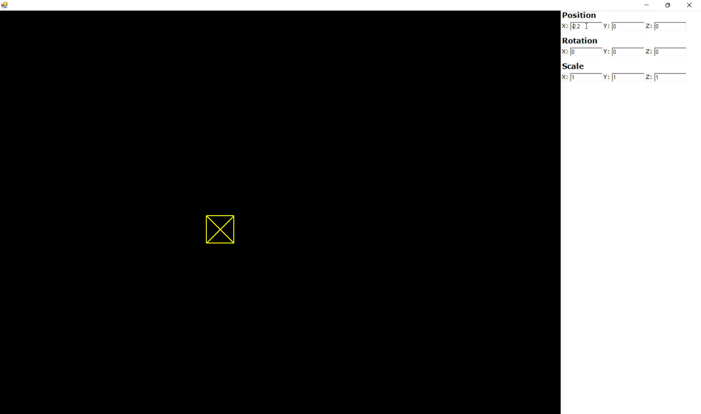

# 3D Graphics Engine - Computer Graphics Coursework

A custom 3D graphics engine built from scratch using C++/CLI and Windows Forms, demonstrating fundamental computer graphics concepts including 3D transformations, wireframe/surface rendering, and backface culling.



## Overview

This project is an educational 3D graphics engine that implements a complete graphics pipeline without relying on external 3D libraries like OpenGL or DirectX. It renders 3D geometric objects (cubes, pyramids) with real-time transformations and supports both wireframe and surface rendering modes.

## Technologies

- **Language**: C++/CLI (C++ with Common Language Infrastructure)
- **Framework**: .NET Framework 4.8
- **GUI**: Windows Forms (WinForms)
- **Graphics API**: GDI+ (System::Drawing)
- **Build System**: MSBuild / Visual Studio 2022
- **Architecture**: Model-View-Controller (MVC) pattern

## Features

- **3D Object Rendering**
  - Wireframe rendering mode (edges only)
  - Surface rendering mode with filled polygons
  - Parametric geometry generation (cubes, pyramids)

- **Real-time Transformations**
  - Position (X, Y, Z translation)
  - Rotation (around X, Y, Z axes)
  - Scale (uniform and per-axis scaling)

- **Advanced Graphics**
  - Backface culling for surface visibility
  - 3D to 2D projection pipeline
  - Matrix-based transformation system

- **User Interface**
  - 80/20 split layout (viewport/controls)
  - Text input for precise transformation values
  - Keyboard controls (arrow keys) for quick adjustments
  - Real-time visual feedback

## Architecture

The project follows a clean **MVC (Model-View-Controller)** pattern:

### Model Layer
- `Model` - Central scene manager
- `Scene` / `SceneOnce` - Scene hierarchy
- `SceneObject` - 3D objects with geometry and transforms
- `Geometric` - Geometry data structures (points, segments, surfaces)
- `Transform` - Position, rotation, scale management
- `Vector3` - 3D vector mathematics
- `Matrix` - Transformation matrix operations

### View Layer
- `View` (abstract base)
  - `ViewEdges` - Wireframe renderer
  - `ViewSurfaces` - Surface renderer with visibility culling
- `OutputBox` - Custom PictureBox for 3D rendering
- `ViewPanel` - Displays current transformation values
- `MyForm` - Main application window

### Controller Layer
- `Controller` - Handles user input and updates model
- `InputPanel` - Text input controls for transformations
- `Panel` - Combined input/view panel container

### Supporting Components
- `GeneratorTransformMatrix` - Creates transformation matrices
- `Segment` - Line segments for rendering
- `Surface` - Polygon surfaces with visibility information
- `Graph`, `Edge`, `Node` - Graph structures for geometry

## Project Structure

```
CGCursach/
├── ComputerGraphic3D.vcxproj    # Main application project
├── Program.cpp                   # Entry point and geometry creation
├── MyForm.h                      # Main WinForms window
├── Controller.h                  # Input handler
├── Model.h / ModelOnce.h         # Scene data model
├── View.h                        # Rendering interfaces
│   ├── ViewEdges.h               # Wireframe renderer
│   └── ViewSurfaces.h            # Surface renderer
├── OutputBox.h                   # Custom rendering canvas
├── Geometric.h                   # Geometry classes
├── Transform.h                   # Transformation system
├── Vector3.h                     # 3D vector math
├── Matrix.h                      # Matrix operations
├── InputPanel.h / Panel.h        # UI controls
└── Math/                         # Math library (DLL)

Additional Projects:
├── MathMatrix/                   # Matrix operations library
├── MVCLibrary/                   # MVC framework
├── Window/                       # Window management
└── TestLibrary1/Tests/           # Unit tests
```

## Building and Running

### Requirements
- Visual Studio 2022 (or later)
- .NET Framework 4.8 SDK
- Windows OS

### Build Steps
1. Open `CGCursach.sln` in Visual Studio
2. Set `CGCursach` as the startup project
3. Select configuration: `Debug|x64` or `Release|x64`
4. Build Solution (Ctrl+Shift+B)
5. Run (F5)

### Configuration Options
- Target Platform: x64 or x86
- CLR Support: Enabled (.NET Framework)
- Character Set: Unicode

## Usage

### Controls

**Text Input:**
- Enter values in the right panel text boxes
- Press Enter to apply transformations
- Values are in:
  - Position: World units
  - Rotation: Degrees
  - Scale: Multiplier (1.0 = normal size)

**Keyboard Controls:**
- Arrow keys: Adjust selected transformation
- Use the panel to select which axis (X/Y/Z) and operation (Position/Rotation/Scale) to modify

### Rendering Modes

The engine supports two rendering modes (set in `Program.cpp`):

```cpp
// Wireframe mode
MVC::View^ view = gcnew MVC::ViewEdges();

// Surface mode (with backface culling)
MVC::View^ view = gcnew MVC::ViewSurfaces();
```

### Creating Custom Geometry

Add geometry creation functions in `Program.cpp`:

```cpp
ReadOnlyGeometric^ CreateCustomObject() {
    List<Vector3>^ points = gcnew List<Vector3>();
    
    // Define vertices
    points->Add(Vector3(x, y, z));
    
    // Define edges
    List<Segment>^ segments = gcnew List<Segment>();
    segments->Add(Segment(points[0], points[1]));
    
    return gcnew ReadOnlyGeometric(points->ToArray(), segments->ToArray());
}
```

Then use it in `main()`:

```cpp
Model^ model = gcnew Model(gcnew SceneOnce(gcnew SceneObject(CreateCustomObject())));
```

## Technical Details

### C++/CLI Language Features

This project uses **C++/CLI**, which bridges native C++ and .NET:

- `ref class` - Managed reference types (garbage collected)
- `^` - Hat operator for managed pointers
- `gcnew` - Allocate managed objects
- `property` - Managed properties with getters/setters
- `value struct` - Stack-allocated value types

### Graphics Pipeline

1. **Geometry Definition** - Vertices and edges defined in object space
2. **Transformation** - Model → World → View → Projection matrices
3. **Culling** - Backface culling removes invisible surfaces
4. **Projection** - 3D coordinates → 2D screen space
5. **Rasterization** - Draw lines/polygons using GDI+

### Coordinate System

- **Right-handed coordinate system**
- X-axis: Right
- Y-axis: Up
- Z-axis: Out of screen

## Known Limitations

- No texture mapping
- No lighting/shading
- No depth buffer (Z-buffer)
- Limited to wireframe and flat-shaded surfaces
- Single object per scene (by design)
- GDI+ rendering (not hardware-accelerated)

## Future Enhancements

- [ ] Multiple objects in scene
- [ ] Camera controls (orbit, pan, zoom)
- [ ] Z-buffer for proper depth sorting
- [ ] Color per surface
- [ ] Simple lighting model (Phong/Gouraud)
- [ ] Export/import 3D models
- [ ] Animation system

## License

Educational project for coursework purposes.

## Author

Developed as a Computer Graphics coursework project demonstrating 3D rendering fundamentals.

---

**Course**: Computer Graphics  
**Year**: 2026  
**Platform**: Windows with .NET Framework
